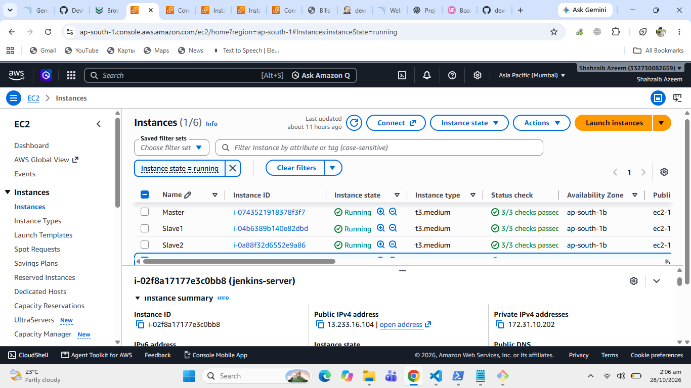
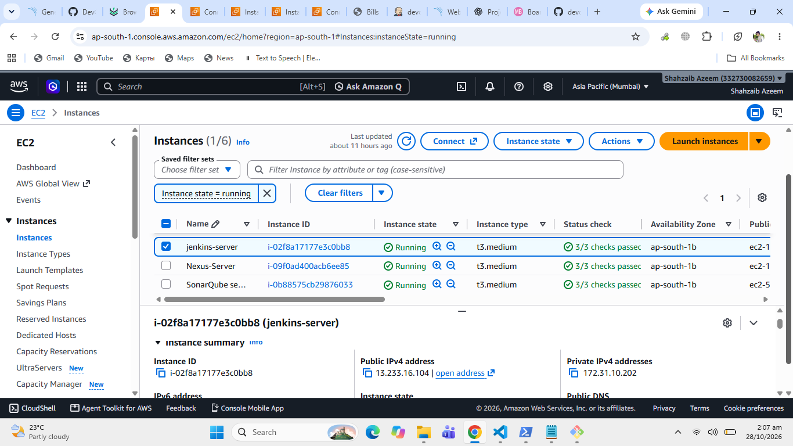
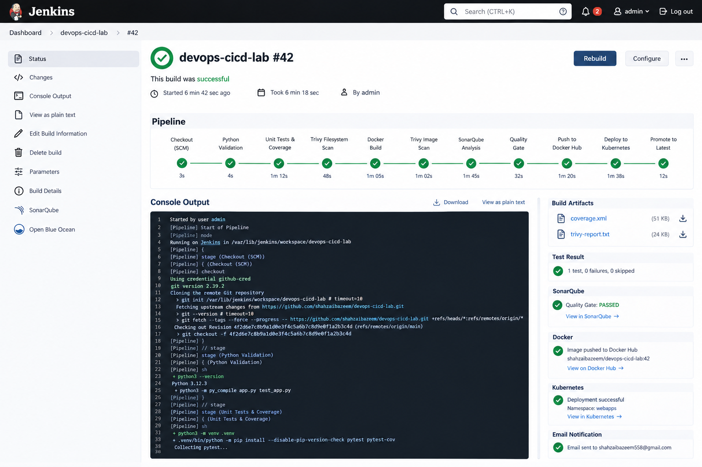
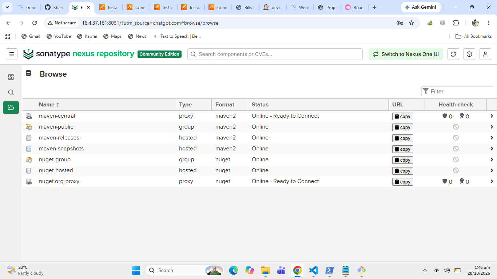
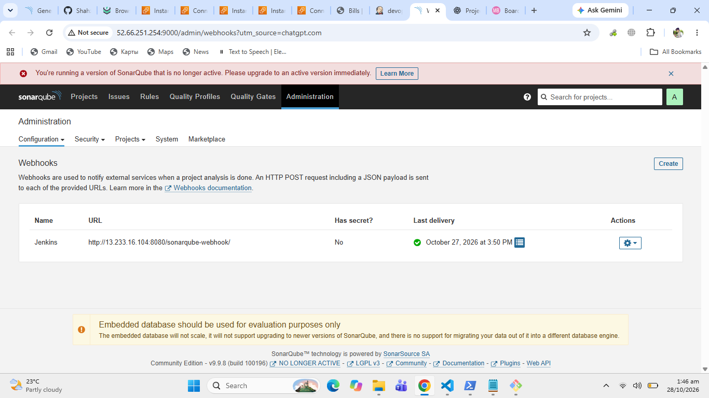
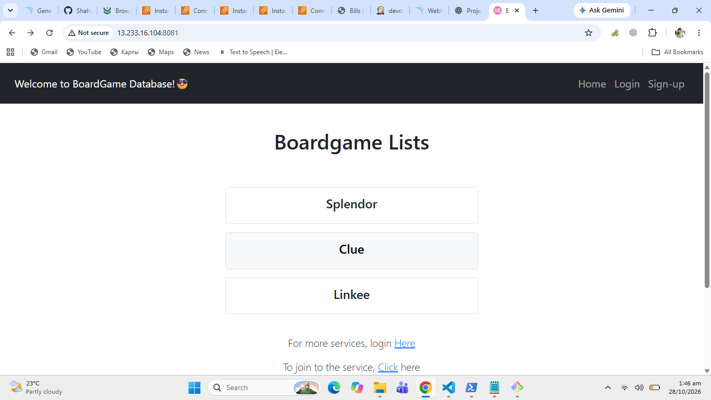

# Boardgame Application — DevOps Implementation

A Java Spring Boot board game application with a DevOps implementation focused on infrastructure setup, source control, CI/CD automation, and monitoring.

> **Project status:** Phases 1–3 completed. Phase 4 — Monitoring — pending.

## Project Overview

This project demonstrates how DevOps tools and practices can be applied to an existing Java/Maven application, from infrastructure and repository setup to automated CI/CD workflows.

**Application:** Boardgame  
**Application technology:** Java, Spring Boot, Maven  
**Containerization:** Docker  
**Container Registry:** Docker Hub

## DevOps Roadmap

### Phase 1 — Infrastructure & Tools Setup ✅

Set up the infrastructure and core DevOps tools required for the project.

- VM/EC2 environment setup
- Kubernetes setup
- Jenkins setup
- Nexus Repository setup
- SonarQube setup
- Application build and containerization preparation

**Screenshots**




### Phase 2 — Git Repository Setup ✅

Configured source-code version control and repository integration.

- Git repository setup
- Source-code version control
- GitHub repository integration
- Repository preparation for CI/CD

**Screenshot**


### Phase 3 — CI/CD Pipeline ✅

Implemented the CI/CD workflow to automate the application delivery process.

- Jenkins pipeline configuration
- Maven build integration
- Automated pipeline execution
- SonarQube code analysis integration
- Quality Gate verification
- Build and pipeline result verification

**Screenshots**






### Phase 4 — Monitoring ⏳

**Status: Pending**

The next phase focuses on application and infrastructure observability.

Planned components:

- **Prometheus:** Metrics collection and monitoring
- **Node Exporter:** Server-level metrics
- **Blackbox Exporter:** Endpoint availability and probe monitoring
- **Grafana:** Monitoring dashboards and visualization

**Planned screenshots**

- Prometheus targets showing healthy monitoring endpoints
- Node Exporter metrics
- Blackbox Exporter probe results
- Grafana monitoring dashboard



## Application Deployment

The application was containerized with Docker and published to Docker Hub.

**Docker Hub image:** [`shahzaibazeem/boardgame-app`](https://hub.docker.com/r/shahzaibazeem/boardgame-app)

Pull the image:

```bash
sudo docker pull shahzaibazeem/boardgame-app:latest
```

Run the application:

```bash
sudo docker run -d \
  --name boardgame-container \
  -p 8081:8080 \
  shahzaibazeem/boardgame-app:latest
```

Verify the container:

```bash
sudo docker ps
```

Check the application response:

```bash
curl -I http://localhost:8081/
```

If the application is running locally on the EC2 instance, access it using:

```text
http://localhost:8081
```

For access from your computer, use the EC2 public address with port `8081`, provided the relevant security-group rule is configured securely.

## Project Structure

```text
Boardgame/
├── src/
├── pom.xml
├── Dockerfile
├── Jenkinsfile
├── screenshots/
└── README.md
```

*The listed files should be adjusted to match the actual repository contents.*

## DevOps Tools & Technologies

- Linux / Ubuntu
- Git and GitHub
- Java and Maven
- Docker
- Kubernetes
- Jenkins
- SonarQube
- Nexus Repository
- Prometheus
- Node Exporter
- Blackbox Exporter
- Grafana
- AWS EC2

## Learning Outcomes

- Infrastructure and DevOps tool configuration
- Source-code management using Git
- Containerizing a Java application
- Automating builds and delivery through CI/CD
- Integrating code-quality analysis
- Planning monitoring and observability for an application

## Attribution

This repository is based on the original Boardgame application. Credit for the original application belongs to its original author. The DevOps configuration, deployment work, and documentation should be distinguished from the original application code.

Please refer to the original repository and its license for attribution and usage requirements.

---

**Current milestone:** Phases 1–3 completed. Monitoring implementation is the next milestone.
